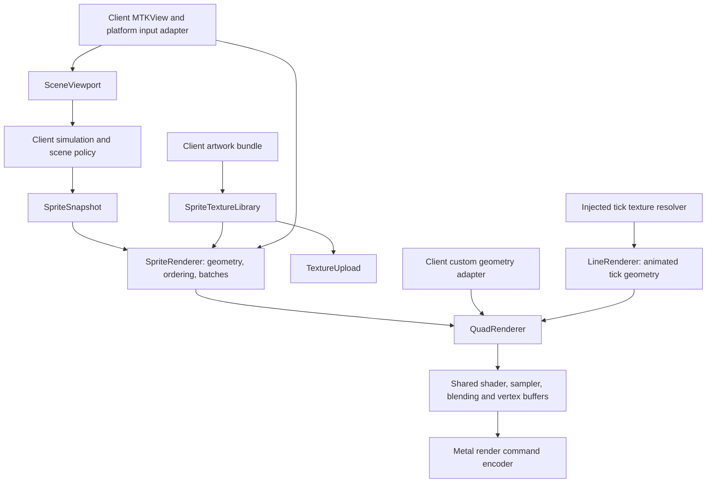

# MetalRack architecture and project-agnostic usage

Analysis of the implementation present on October 15, 2026. This document describes existing behavior and distinguishes it from possible future improvements. The package source is authoritative; no renderer behavior was changed for this analysis.

## Purpose and scope

MetalRack is a small Apple-platform 2D rendering library. Its reusable abstraction is **textured, colored geometry plus a destination viewport**. It translates that data into Metal commands without knowing what the objects represent.

The package is a SwiftPM library named `MetalRack`, with Swift tools version 5.9 and minimum deployment targets of iOS 17 and macOS 14. It requires a working Metal device. The core uses MetalKit, CoreGraphics, ImageIO and SIMD; it does not require UIKit. UIImage and related SwiftUI conveniences are separately compiled under `canImport(UIKit)`.

“Project agnostic” means client applications supply asset names, artwork bundles, scene state and application policies. It does not mean the current library supports every graphics workload or rendering configuration. It is a focused 2D renderer with concrete defaults, not a complete game engine, general 3D engine, scene editor or platform-independent graphics backend.

## Architecture



`SpriteRenderer`, `LineRenderer` and custom client adapters share the same `QuadRenderer` implementation for textured triangles. They can own separate instances, queues and caches; sharing an implementation does not imply a process-wide singleton or shared GPU allocations between applications.

`PreviewRenderer` is a separate diagnostic triangle pipeline. It is not another sprite renderer. The SwiftUI `EffectSprite` path also needs to be distinguished from Metal sprite rendering: it animates a SwiftUI image view rather than adding a special effect pipeline to `QuadRenderer`.

### Component responsibilities

| Component | What it owns | What it leaves to the client |
| --- | --- | --- |
| [SpriteSnapshot](../Sources/MetalRack/SpriteSnapshot.swift) | Frame data: logical size, background name, sprite properties | Meaning of objects, simulation, asset selection, animation state |
| [SpriteRenderer](../Sources/MetalRack/SpriteRenderer.swift) | Frame clock, sprite geometry, stable sorting, contiguous batching, command queue, presentation, DEBUG macOS capture | View hosting/configuration, snapshot production, error UI, lifecycle policy |
| [QuadRenderer](../Sources/MetalRack/QuadRenderer.swift) | Textured triangle pipeline, sampler, blending, vertex upload and reusable frame buffers | Geometry generation, texture ownership, queue, render pass, encoder, command commit and presentation |
| [SpriteTextureLibrary](../Sources/MetalRack/SpriteTextureLibrary.swift) | Named image texture cache and atlas-region lookup | Artwork, atlas generation and valid metadata, bundle selection, cache lifetime |
| [TextureUpload](../Sources/MetalRack/TextureUpload.swift) | CGImage decoding into premultiplied BGRA and GPU upload | Image discovery, desired color space and vertical orientation |
| [SceneViewport](../Sources/MetalRack/SceneViewport.swift) | Aspect-fit display/logical coordinate conversion | Hit regions, pointer-origin normalization, clipping and input consumption |
| [LineRenderer](../Sources/MetalRack/LineRenderer.swift) | Animated Bezier tick geometry, tick cache, its own draw lifecycle using the common core | Segment endpoints, tick asset names, texture resolver and host view |
| [PreviewRenderer](../Sources/MetalRack/PreviewRenderer.swift) | Runtime-compiled colored test triangle | Diagnostic view hosting and interpretation of failures |
| [ImageLibrary](../Sources/MetalRack/ImageLibrary.swift), [SpriteImage](../Sources/MetalRack/SpriteImage.swift), [EffectSprite](../Sources/MetalRack/EffectSprite.swift) | UIKit image lookup adapter, SwiftUI fallback images and frame animation | Lookup policy, placeholders, animation parameters and placement |

## How a sprite frame becomes pixels

`SpriteRenderer` implements `MTKViewDelegate`. A draw proceeds as follows:

1. Require a positive drawable size, drawable, render pass, command buffer and snapshot callback. If any is unavailable, return without advancing the snapshot clock.
2. Read `CACurrentMediaTime()`. The first delta is zero; subsequent deltas are clamped to 0–0.1 seconds. Invoke `makeSnapshot(delta)` synchronously.
3. Resolve and draw the background first, centered and scaled to fill the entire drawable.
4. Construct a `SceneViewport` for the logical scene. Sprites aspect-fit into the drawable, potentially leaving space around the logical scene through which the background is visible.
5. Sort sprites by ascending `zIndex`. Equal indices preserve their order in the snapshot array. There is no depth-buffer-based ordering.
6. Apply conservative visibility checks, resolve each remaining sprite's texture region, and create six vertices per quad. Anchor, rotation, horizontal flip and tint are incorporated into those vertices.
7. Merge **adjacent** geometry using the same texture object into one batch. It does not sort by texture, because doing so could alter transparent compositing and layer order.
8. Acquire a frame-buffer slot and encode batches through `QuadRenderer`. End encoding, present the drawable and commit. GPU completion releases the slot and reports command-buffer errors through `onFailure`.

This makes atlases useful: many adjacent sprites can share one texture and therefore one draw call. The package does not use hardware instancing, indexed quads or GPU-driven sorting. Geometry creation, sorting and batch slicing occur on the CPU each frame.

The snapshot is a value representation of what to draw, not a retained scene graph. It contains no entities, collision logic, input callbacks, parent-child transforms or gameplay types. Sprite animation in this path means the client changes image names/transforms between snapshots.

## Coordinate and color contracts

### Coordinates

Sprite logical coordinates have a top-left origin, with x increasing right and y increasing down. Position identifies the sprite's anchor point. The default anchor `(0.5, 0.5)` centers the quad; `(0, 0)` places its top-left corner at the position. Size is expressed in logical units. Rotation is in radians about the anchor; with this downward y axis, positive rotation appears clockwise. `flippedX` reverses horizontal texture coordinates without changing geometry.

For logical size `(Lw, Lh)` and display size `(Dw, Dh)`:

```text
scale  = min(Dw / Lw, Dh / Lh)
offset = ((Dw - Lw * scale) / 2, (Dh - Lh * scale) / 2)
displayPoint = logicalPoint * scale + offset
```

Use drawable pixels for rendering. For input, construct the same transform with the view's bounds size if pointer coordinates are in view points. Matching the coordinate units is more important than using identical numeric display dimensions. Native event adapters must first normalize their origin to top-left coordinates.

`logicalPoint(from:)` returns nil for an invalid/empty viewport. It does **not** reject letterbox areas or points outside the logical scene: those convert to out-of-bounds logical coordinates. Clients decide whether those points should dismiss an overlay, hit a world object or be ignored.

`QuadRenderer` receives already-transformed viewport-space vertices. Its vertex shader maps x to `2*x/width - 1` and y to `1 - 2*y/height`, producing Metal clip coordinates. It performs no camera or scene transform itself.

### Alpha and texture format

`TextureUpload` produces `.bgra8Unorm` textures containing premultiplied color. The shader multiplies sampled RGBA by the vertex color. Blending uses source factor `.one` and destination factor `.oneMinusSourceAlpha`, for both color and alpha.

The two public levels deliberately have different color inputs:

- `SpriteSnapshot.Sprite.tint` is ordinary RGBA. `SpriteRenderer` multiplies its RGB components by tint alpha before producing vertices.
- `QuadRenderer.Vertex.color` must already be premultiplied. Half-opacity red is `(0.5, 0, 0, 0.5)`, not `(1, 0, 0, 0.5)`.

Clients supplying their own textures must honor the same alpha convention. The default sampler uses linear filtering and clamps at the texture edges. There are no mipmaps. The current pipeline is fixed to a `.bgra8Unorm` color attachment and its default single-sample configuration; configure the destination view/pass accordingly.

## Buffer lifetime and submission rules

The common core supports two upload paths:

- Up to 4,096 bytes per encode call use `setVertexBytes`.
- Larger calls use shared-storage buffers, with each allocation starting at a 256-byte-aligned offset.

There are three reusable frame slots. Initial pooled capacity is 256 KiB; capacity doubles as needed. Each slot's actual buffer length is checked before writing, even when another slot previously grew. Multiple large batches in one frame occupy separate regions. If a buffer grows during encoding, prior encoder references retain the earlier buffer for their submitted work.

`beginFrame(commandBuffer:)` waits on a three-frame semaphore, advances the ring and resets its write offset. The command buffer's completion handler signals the semaphore. Consequently:

- Use an instance serially with a single command queue, so completion order matches slot reuse.
- Call `beginFrame` once for each frame's command buffer before encoding geometry.
- Commit every command buffer handed to `beginFrame`, including error paths. Abandoning such buffers can exhaust the semaphore and stall later frames.
- Do not mutate renderer/cache state concurrently with drawing. These mutable classes do not provide general thread safety or actor isolation.
- Keep textures, command encoders, render passes and the renderer's Metal device compatible. `QuadRenderer` does not create or present the destination surface.

Allocation failure in the low-level vertex upload currently causes that encode call to return without drawing; it is not thrown. The throwing `SpriteRenderer` initializer reports setup errors, but that does not make every later GPU allocation failure observable through its callback.

## Resource and atlas model

There are two independent resource owners:

1. **Package shaders:** SwiftPM copies `Resources/QuadShaders.txt` to the resource-bundle root; `QuadRenderer` reads `QuadShaders.txt` through `Bundle.module` and compiles it at runtime. This avoids requiring the separate offline Metal compiler toolchain. A new core instance builds its own library/pipeline; there is no global pipeline cache.
2. **Client artwork:** `SpriteTextureLibrary` uses the bundle supplied at initialization, defaulting to `.main`. The package ships no application artwork or mandated atlas name. Pass `atlasResource: nil` to resolve standalone image files only.

An optional primary atlas uses this JSON shape:

```json
{
  "frames": {
    "icon": { "frame": { "x": 0, "y": 0, "w": 64, "h": 64 } }
  },
  "meta": { "image": "sheet.png", "size": { "w": 256, "h": 256 } }
}
```

`registerAtlas(resource:prefix:)` adds another atlas from the same artwork bundle. Additional registered regions take precedence over the primary atlas, followed by standalone image lookup. Prefixes such as `"interface/"` avoid name collisions. Registration with the same final name replaces that region entry.

Frame rectangles are normalized against metadata dimensions to form UV rectangles. Regions expose an aspect ratio, but sprite sizes remain client-supplied. The current format has no rotated-frame, trimming-offset or pivot support, and no metadata validation beyond decoding. Atlas packers must emit compatible unrotated rectangles and appropriate edge padding for linear filtering.

Texture files are decoded on demand through ImageIO, with orientation transforms and a maximum decoded dimension of 4,096 pixels. A primary atlas's image is loaded during initialization; an additional atlas's image is loaded during registration. Textures are retained by name for the library lifetime. There is no eviction, explicit invalidation, asynchronous preload API or asset-catalog lookup in this file-based library. Resolve known artwork ahead of drawing when first-use decode/upload latency matters.

Use a standalone image as `backgroundImage`: the current aspect-fill calculation uses the resolved texture's full dimensions, not an atlas frame's dimensions. Every `SpriteSnapshot` currently requires a background name; a background-free scene needs the lower-level API or a suitable client-provided background image.

## Intended integration patterns

### Pattern 1: ordinary sprite scenes

Choose `SpriteRenderer` when the scene can be expressed as image quads with transforms, tint and ordered layers. Supply assets, retain the renderer in a session/controller, and let the platform adapter host an MTKView.

The following setup assumes `background.png` and `marker.png` are supplied by the client bundle:

```swift
import Foundation
import MetalKit
import MetalRack

func makeDemoRenderer(view: MTKView, artwork: Bundle) throws -> SpriteRenderer {
    let renderer = try SpriteRenderer(bundle: artwork)
    var elapsed: TimeInterval = 0

    renderer.makeSnapshot = { delta in
        elapsed += delta
        return SpriteSnapshot(
            logicalSize: CGSize(width: 800, height: 450),
            backgroundImage: "background.png",
            sprites: [SpriteSnapshot.Sprite(
                image: "marker.png",
                position: CGPoint(x: 400 + sin(elapsed) * 100, y: 225),
                size: CGSize(width: 64, height: 64),
                zIndex: 1
            )]
        )
    }

    renderer.onFailure = { message in
        DispatchQueue.main.async { print("Rendering failed: \(message)") }
    }
    view.device = renderer.device
    view.colorPixelFormat = .bgra8Unorm
    view.sampleCount = 1
    view.depthStencilPixelFormat = .invalid
    view.clearColor = MTLClearColorMake(0, 0, 0, 1)
    view.preferredFramesPerSecond = 60
    view.enableSetNeedsDisplay = false
    view.isPaused = false
    view.delegate = renderer
    return renderer // Store strongly in the owning session/controller.
}
```

A real application usually calls its own simulation/snapshot adapter from the callback. Keep that adapter outside the package. Avoid a closure-retention cycle when an owner retains the renderer and the renderer's callback references that owner. Call `resetClock()` on resume when appropriate; the library clamps elapsed time but does not implement background lifecycle or fixed-step simulation.

Geometry/resource errors pause the view and invoke `onFailure`. GPU completion errors invoke the captured failure callback asynchronously and do not automatically apply the same pause policy. Dispatch UI work to the main thread. Recovery, retry UI and error logging belong to the host.

### Pattern 2: custom geometry or application-specific rendering adapters

Choose `QuadRenderer` when the application already computes specialized world/HUD geometry, dynamic text textures, gradients, tiled surfaces or a custom viewport. Keep the layout and asset rules in that application's adapter and submit its triangles through the shared core.

A submission helper can maintain the required lifecycle without recreating a second rendering pipeline:

```swift
func submitFrame(
    view: MTKView,
    queue: MTLCommandQueue,
    core: QuadRenderer,
    texture: MTLTexture,
    vertices: [QuadRenderer.Vertex]
) {
    guard view.drawableSize.width > 0, view.drawableSize.height > 0,
          let drawable = view.currentDrawable,
          let pass = view.currentRenderPassDescriptor,
          let command = queue.makeCommandBuffer(),
          let encoder = command.makeRenderCommandEncoder(descriptor: pass)
    else { return }

    core.beginFrame(commandBuffer: command)
    defer {
        encoder.endEncoding()
        command.present(drawable)
        command.commit()
    }
    core.encode(texture: texture, vertices: vertices,
                viewportSize: view.drawableSize, encoder: encoder)
    // Additional ordered batches may use the same encoder and core.
}
```

Create and retain the core, queue and textures outside this function. Supply triangle-list vertices, a positive viewport and compatible single-sample BGRA destination. Custom adapters own batching: the core draws each encode call as submitted and does not merge or sort them.

This is the pattern used for specialized game HUD/layout rendering. It shares the GPU implementation while allowing application-specific presentation logic. Putting another quad shader, blend pipeline or frame-buffer allocator in the application would undermine that boundary.

### Pattern 3: animated lines and SwiftUI effects

Use `LineRenderer` for decorative image ticks along straight or animated cubic Bezier paths. Inject a `(MTLDevice, String) -> Tick?` resolver and set `segments`. `Tick` supplies the texture and display size. On UIKit, `init(imageLoader:)` converts UIImage data through `TextureUpload` with vertical flipping.

Current line behavior has specific limits: the **first segment's** image name and tick size are used for all segments in that renderer. Changing the segment array resets animation states when its value changes. Successful tick loads are cached. Short segments are omitted, ticks are capped at 100 per segment, and spacing derives from image width. Travel advances with clamped delta time, while control-angle adjustments occur per draw, so the entire animation is not strictly frame-rate independent. Coordinates are view-bounds units, unlike `SpriteRenderer`'s drawable-pixel geometry path. Use separate line instances if different tick textures are needed simultaneously.

Use `SpriteImage` for first-resolvable-image/fallback SwiftUI content, and `EffectSprite` for timed frame-name cycling with opacity, scale, blend mode and optional random rotation. Zero repeat count loops indefinitely; positive counts hold the last frame after completion. These helpers depend on mutable `ImageLibrary.shared`, whose loader the application can replace. `ImageLibrary` itself is a lookup adapter, not a GPU cache. These helpers are UIKit-only today; macOS clients can use the generic Metal sprite path or their own AppKit/SwiftUI image adapter.

## What belongs outside the package

A new client should own:

- Application windows, orientation, fullscreen/cursor policy, view scale and lifecycle.
- Input event translation, hit shapes, modal interaction rules and gesture handling.
- Simulation, game objects, animation timelines, cameras and logical scene dimensions.
- Art, atlas preparation, image names, asset fallbacks, text layout and fonts.
- HUD placement, room/map layout, application-specific effects and performance reporting.

The package should own reusable rendering mechanisms: geometry submission, compatible texture upload, reusable resource lookup, generic frame data and transformations, and rendering utilities whose inputs can be supplied without importing a client domain model.

The existing consumers demonstrate the two intended boundaries: Rocket produces generic sprite snapshots directly, while ZombieSwift retains a specialized gameplay presentation adapter that calls `QuadRenderer`. Neither consumer's source is required to understand or implement a new client.

## Current limitations and extension points

The main reusable mechanisms are present, but several defaults remain intentionally concrete:

- No public render-state selection for alternate color formats, MSAA, additive blending, depth or stencil; no built-in clipping, postprocessing, lighting or 3D camera.
- No built-in Metal text rendering, font atlas policy, particle simulation or generalized effect graph. Clients may generate textures/geometry and use the shared core.
- No generic packaged SwiftUI MTKView host or platform input view. Applications provide their own UIViewRepresentable/NSViewRepresentable or native controller.
- Snapshot culling uses a diagonal-based radius around position. It is conservative for ordinary in-quad anchors, but unrestricted extreme anchor values are not included in that bound.
- Sprite rendering assumes valid finite sizes, positions and atlas metadata. `SceneViewport` guards invalid dimensions; the entire rendering API is not a general input-validation layer.
- Caches have lifetime-based retention, and mutable renderer objects require serialized use. Frequent construction recompiles pipelines and recreates caches.
- Capture is available only under `DEBUG && os(macOS)`, is synchronous, and waits for GPU readback. It is a verification facility rather than a real-time export API. Its blit-encoder failure path currently throws after acquiring a core frame slot without committing the command buffer; repeated failures on that path could stall later submissions.
- Line/preview setup uses optional state and suppressed pipeline errors rather than the throwing setup/error callback interface offered by `SpriteRenderer`.

Potential improvements should extend these generic mechanisms with explicit inputs and tests—for example, configurable pipeline descriptors, cache policies, injectable clocks, robust capture cleanup or platform-neutral view hosting. Client names, game asset constants and gameplay-specific snapshots should remain outside the library.

## Verification and maintenance guidance

The package's [RenderingTests](../Tests/MetalRackTests/RenderingTests.swift) cover aspect-fit round trips, invalid viewports, and real GPU readback of premultiplied blending through inline and pooled uploads, including buffer growth and ring-slot reuse. Run from the package root:

```sh
swift test
```

Those tests require Metal and do not silently skip GPU verification. They do not establish full coverage of atlases, sprite ordering, resource errors, line animation, SwiftUI effects or every failure path described above.

The existing Rocket `Tools/verify_rendering.sh` provides a consumer-level GPU check using the built package, scene snapshots and native coordinate handling. Such client-specific behavior tests belong in the client project. Package tests should focus on rendering contracts independent of any application's objects or art.

For a new client, verify at least resource lookup from its chosen bundle, translucent edge/tint behavior, render/input agreement at different aspect ratios and display scales, and startup/resume/error handling. Preserve the central architectural constraint: application adapters decide **what and where**, while the common renderer owns **how compatible geometry reaches the GPU**.


## October 16 resource packaging correction

SwiftPM now copies `Resources/QuadShaders.txt` individually to the resource-bundle
root. Copying the directory named `Resources` produced an ambiguous iOS bundle
that failed Xcode code signing. QuadRenderer checks the bundle root first and
retains the former nested lookup as a fallback. Shader bytes, rendering APIs and
client responsibilities are unchanged.
